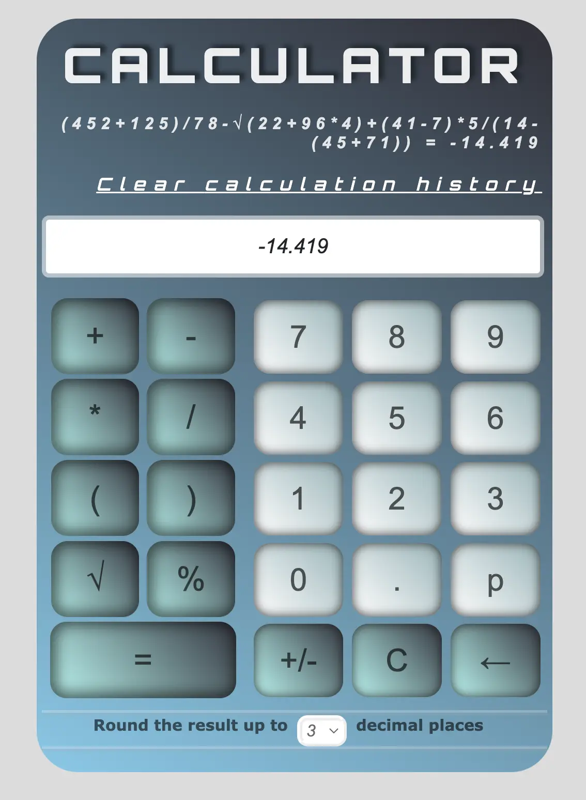

# Expression Calculator

A responsive calculator for evaluating mathematical expressions, including expressions with parentheses. The interface uses a mobile-first layout and adapts to different screen sizes.

## Technologies

- HTML5
- CSS3
- Vanilla JavaScript

## Live Demo

[View the demo](https://oxana88.github.io/calculator/)

## Screenshots

### Mobile

